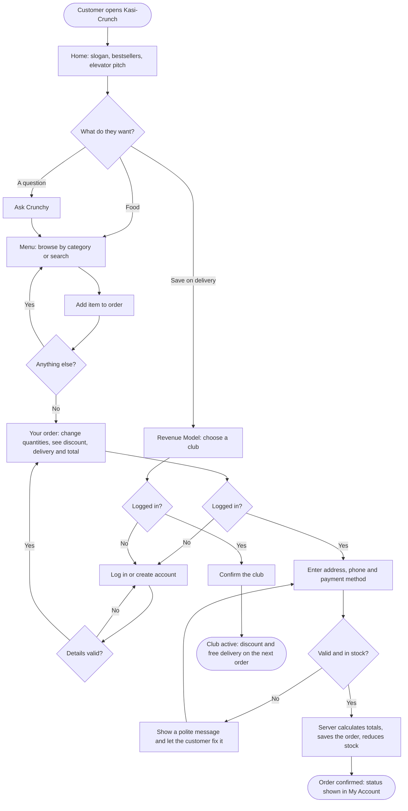

# Kasi-Crunch — Design Document

JGA 2026 · Theme: Digital Entrepreneurship for Sustainable Community Development
Slogan: *"Crunch outside, juicy inside"*

This document holds the Phase 1 design work for the web application: the
problem statement, variables and parameters, the user flowchart, pseudocode
for the main feature, and IPO tables for every action in the prototype.

---

## 1. Problem statement

In townships like Soshanguve, students, families and workers who want a quick,
hot meal often have to take a taxi to a mall food court, or rely on delivery
apps that don't always reach their streets. At the same time, kasi cooks make
excellent food but can only sell to people who walk past. Kasi-Crunch is a
township fried-chicken brand with its own online ordering. Food is cooked in
the kasi and delivered by local runners, so customers save time and money and
the income and jobs stay in the community.

**Customer:** Thandi, a 20-year-old student living in a residence in Soshanguve.

**Problem in one sentence:** People in the township can't easily get good,
affordable hot food delivered, and local food businesses can't easily reach them.

**How it makes money:** e-commerce food sales (the main income), plus monthly
club subscriptions for steady, predictable income, plus delivery fees that pay
local runners.

---

## 2. Variables and parameters

A **variable** changes as the system runs; a **parameter** is fixed for now.

| Name | Type | Value / example | Where it lives |
|---|---|---|---|
| Delivery fee | Parameter | R25.00 | `Pricing.DELIVERY_FEE` |
| Free-delivery threshold | Parameter | R250.00 (order must be **over** this) | `Pricing.FREE_DELIVERY_THRESHOLD` |
| Crunch Club price | Parameter | R49 per month, free delivery | `plans` table |
| Family Club price / discount | Parameter | R129 per month, free delivery, 10% off | `plans` table |
| Max quantity per item | Parameter | 20 | `Pricing.MAX_QUANTITY_PER_ITEM` |
| Days per month (conversion) | Parameter | 30.44 | `Statistics.DAYS_PER_MONTH` |
| Menu price | Variable | e.g. R89.90 | `products.price` |
| Food cost per item | Variable | e.g. R39.00 | `products.cost` |
| Daily stock | Variable | e.g. 80 | `products.stock` |
| Quantity in order | Variable | 1–20 | browser cart, `order_items.quantity` |
| Subtotal | Variable | sum of price × quantity | calculated in `OrderHandler` |
| Club discount | Variable | subtotal × discount rate | `orders.discount` |
| Order total | Variable | subtotal − discount + delivery | `orders.total` |
| Food cost of order | Variable | sum of cost × quantity | `orders.food_cost` |
| Orders per day | Variable | e.g. 2.2 | admin dashboard |
| Club members | Variable | e.g. 3 | `subscriptions` |

### Formulas

```
discount           = subtotal × club discount rate          (0 if not in a club)
deliveryFee        = 0    if in a club or subtotal > 250
                   = 25   otherwise
orderTotal         = subtotal − discount + deliveryFee
grossProfit        = (food sales − discounts) − food cost
margin %           = grossProfit ÷ food sales × 100
ordersPerMonth     = ordersPerDay × 30.44
mean               = sum of order totals ÷ number of orders
median             = middle order total once sorted (average of the two middle values if even)
range              = largest order total − smallest order total
percentage         = part ÷ whole × 100
benefit-cost ratio = total income ÷ total costs   (above 1 means benefits outweigh costs)
```

The first-year cash-flow, profit/loss and cost-benefit projection is built
into the **Revenue Model** page (`revenue.html`). Every assumption can be
changed there, and the month-by-month table can be copied into Excel.

---

## 3. Flowchart — landing page to completed order or club sign-up



---

## 4. Pseudocode — main feature: placing an order

```
1.  START when the customer presses "Place order"
2.  IF the customer is not logged in THEN
3.      SHOW "Please log in or create an account to place your order"
4.      STOP
5.  READ address, phone, payment method and the items in the order
6.  IF address is shorter than 5 characters THEN show a message and STOP
7.  IF phone is not a South African number THEN show a message and STOP
8.  IF the order is empty THEN show "Your cart is empty" and STOP
9.  SET subtotal = 0 and foodCost = 0
10. FOR EACH item in the order
11.     LOOK UP the item's current price, food cost and stock
12.     IF the item is no longer on the menu THEN show a message and STOP
13.     IF quantity < 1 OR quantity > 20 THEN show a message and STOP
14.     IF quantity > stock THEN show "Only <stock> left today" and STOP
15.     ADD price × quantity to subtotal
16.     ADD cost × quantity to foodCost
17. END FOR
18. LOOK UP the customer's active club (if any)
19. SET discount = subtotal × club discount rate   (0 if no club)
20. IF the customer is in a club OR subtotal > 250 THEN
21.     SET deliveryFee = 0
22. ELSE
23.     SET deliveryFee = 25
24. SET total = subtotal − discount + deliveryFee
25. SAVE the order and each item; REDUCE each item's stock
26. EMPTY the cart
27. SHOW "Thank you! Order #<number> is in" with the total
28. STOP
```

This pseudocode is implemented in `OrderHandler.placeOrder()` and the
`Pricing` class. The browser repeats steps 6–8 and 18–24 for instant feedback,
but the server always decides the final amounts.

---

## 5. IPO tables

Each table lists the inputs, the processing, the output, and what happens when
an input is invalid. Every error message is polite and tells the user how to
fix it; the server never crashes on bad input.

### 5.1 Register

| Input | Processing | Output |
|---|---|---|
| Full name, email, password, confirm password | Check each field; check the email is not taken; hash the password (PBKDF2); save; start a session | Logged in and sent to the menu |

| Invalid input | Response |
|---|---|
| Name shorter than 2 characters | "Please enter your full name." |
| Email without @ or domain | "Please enter a valid email address, for example name@example.com." |
| Password under 8 characters, or no letter/number | "Please choose a password of at least 8 characters with at least one letter and one number." |
| Passwords differ | "The passwords do not match." |
| Email already registered | "An account with that email already exists. Please log in instead." |

### 5.2 Log in

| Input | Processing | Output |
|---|---|---|
| Email, password | Find the user; verify the password against the stored hash; create a session cookie | Logged in; the admin goes to the Dashboard |

| Invalid input | Response |
|---|---|
| Empty field | "Please enter your email and password." |
| Unknown email or wrong password | "That email and password do not match our records." (the same message for both) |

### 5.3 Browse and search the menu

| Input | Processing | Output |
|---|---|---|
| Search words, category | Find items whose name, description or category matches | Menu grouped by category |

| Invalid input | Response |
|---|---|
| Search longer than 60 characters | "Please use a shorter search of up to 60 characters." |
| No matches | "Nothing matches that. Try another word or category." |

### 5.4 Add to order / change quantity

| Input | Processing | Output |
|---|---|---|
| Item, + / − | Store it in the browser cart; recalculate subtotal, discount, delivery and total | Updated order and summary |

| Invalid input | Response |
|---|---|
| More than 20 of one item, or more than today's stock | "You can add at most 20 × <item>." |
| Quantity reduced to 0 | Item is removed |
| Sold-out item | "+ Add" is replaced by "Sold out today" |

### 5.5 Checkout (place order)

| Input | Processing | Output |
|---|---|---|
| Items, address, phone, payment method | See the pseudocode above | Order number and total; order saved |

| Invalid input | Response |
|---|---|
| Not logged in | "Please log in or create an account to place your order." |
| Address under 5 characters | "Please enter your delivery address (at least 5 characters)." |
| Phone not 0XXXXXXXXX or +27XXXXXXXXX | "Please enter a South African phone number, for example 0712345678." |
| Quantity above stock | "Sorry, only <n> × <item> left today. Please lower the quantity." |
| Item removed from the menu | "One of the items in your cart is no longer on the menu…" |
| Tampered cart text | "We could not read your cart. Please refresh the page and try again." |

### 5.6 Join, change or cancel a club

| Input | Processing | Output |
|---|---|---|
| Club (Crunch Club or Family Club) | End any current club; save the new subscription | "Welcome to the <club>!" |

| Invalid input | Response |
|---|---|
| Not logged in | Asked to log in, then returned to the clubs |
| Already in that club | "You are already in the <club>. Enjoy!" |
| Cancel with no club | "You are not in a club at the moment." |
| Admin account | "The admin account cannot join a club…" |

### 5.7 Admin: add a menu item

| Input | Processing | Output |
|---|---|---|
| Name, description, category, price, food cost, daily stock, emoji, spicy | Validate and save | "<item> was added to the menu." |

| Invalid input | Response |
|---|---|
| Price 0, negative, letters or over R5000 | "Please enter a price between R1 and R5000." |
| Food cost ≥ price | "The food cost must be lower than the selling price, otherwise every sale makes a loss." |
| Stock negative, decimal or over 10 000 | "Please enter a daily stock between 0 and 10000." |
| Not the admin | "You do not have access to this area." |

### 5.8 Contact form

| Input | Processing | Output |
|---|---|---|
| Name, email, subject, message | Validate and save to `contact_messages` | "Thanks, <name>! We received your message…" |

| Invalid input | Response |
|---|---|
| Message under 10 characters | "Please write a message of at least 10 characters." |
| Invalid email | "Please enter a valid email address…" |

### 5.9 Ask Crunchy

| Input | Processing | Output |
|---|---|---|
| A question (1–300 characters) | Match keywords (delivery, clubs, spicy, budget, payment, order status…); otherwise search the menu | An answer, sometimes with menu items and "+ Add" buttons |

| Invalid input | Response |
|---|---|
| Empty question | Nothing is sent |
| Unrecognised question | "Eish, I didn't catch that. Try "wings", "kota", "something spicy"…" |

### 5.10 Admin: update order status

| Input | Processing | Output |
|---|---|---|
| Order number, new status (Placed, Preparing, Out for delivery, Delivered, Cancelled) | Check admin role; update the order | "Order #<n> is now marked as <status>." |

| Invalid input | Response |
|---|---|
| Not the admin | "You do not have access to this area." |
| Unknown status or order | "Please choose a valid status." / "Order #<n> does not exist." |

---

## 6. Database design

| Table | Purpose | Key columns |
|---|---|---|
| `users` | Customers and the admin | `email` (unique), `password_hash` (PBKDF2), `role` |
| `sessions` | Logged-in sessions | `token` (random, 64 hex), `expires_at` |
| `plans` | Crunch Club and Family Club | `price_monthly`, `discount_rate`, `free_delivery` |
| `products` | The menu | `category`, `price`, `cost`, `stock`, `popular`, `spicy` |
| `orders` | One row per checkout | `subtotal`, `discount`, `delivery_fee`, `total`, `food_cost`, `status` |
| `order_items` | Items in each order | `quantity`, `unit_price`, `unit_cost` (prices at the time of the order) |
| `subscriptions` | Active and cancelled club memberships | `user_id`, `plan_id`, `status` |
| `contact_messages` | Contact form messages | `subject`, `message` |

The schema is created automatically by `Database.java` the first time the app starts.
