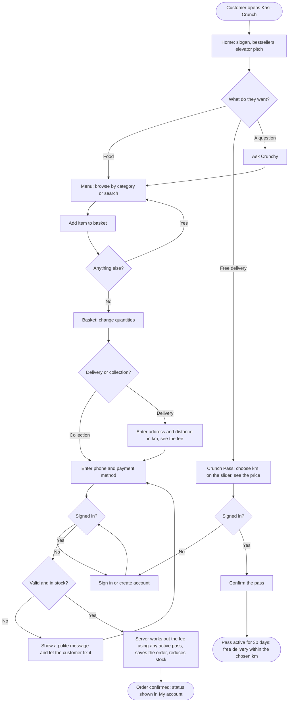

# Kasi-Crunch — Design Document

JGA 2026 · Theme: Digital Entrepreneurship for Sustainable Community Development
Slogan: *"Crunch outside, juicy inside"*

This document holds the Phase 1 design work for the web application: the
problem statement, variables and parameters, the user flowchart, pseudocode
for the main features, and IPO tables for every action in the prototype.

---

## 1. Problem statement

In townships like Soshanguve, students, families and workers who want a quick,
hot meal often have to take a taxi to a mall food court, or rely on delivery
apps that don't always reach their streets. Kasi-Crunch is one kasi kitchen
(our own; there are no other stores or vendors) with simple online ordering,
like a McDonald's app. Customers choose delivery, priced fairly by distance, or
free collection. Regulars can buy a Crunch Pass for free delivery all month,
priced by how far they live. Customers save time and money, and the income and
jobs stay in the community.

**Customer:** Thandi, a 20-year-old student living in a residence 4 km from our kitchen.

**Problem in one sentence:** People in the township can't easily get good,
affordable hot food delivered close to home.

**How it makes money:** e-commerce food sales (the main income), delivery fees
by distance (which pay local runners), and Crunch Pass subscriptions for steady
monthly income.

---

## 2. Variables and parameters

A **variable** changes as the system runs; a **parameter** is fixed for now.

| Name | Type | Value / example | Where it lives |
|---|---|---|---|
| Delivery rate | Parameter | R16 per km | `Pricing.DELIVERY_RATE_PER_KM` |
| Furthest delivery | Parameter | 30 km | `Pricing.MAX_DELIVERY_KM` |
| Pass base price | Parameter | R49 per month | `Pricing.PASS_BASE_PRICE` |
| Pass rate per km | Parameter | R15 per km per month | `Pricing.PASS_RATE_PER_KM` |
| Pass distance range | Parameter | 1–20 km | `Pricing.PASS_MIN_KM`, `PASS_MAX_KM` |
| Pass length | Parameter | 30 days | `Pricing.PASS_DAYS` |
| Max quantity per item | Parameter | 20 | `Pricing.MAX_QUANTITY_PER_ITEM` |
| Days per month (conversion) | Parameter | 30.44 | `Statistics.DAYS_PER_MONTH` |
| Menu price | Variable | e.g. R82 | `products.price` |
| Food cost per item | Variable | e.g. R34 | `products.cost` |
| Daily stock | Variable | e.g. 120 | `products.stock` |
| Fulfilment | Variable | delivery or collection | `orders.fulfilment` |
| Delivery distance | Variable | e.g. 4.5 km | `orders.distance_km` |
| Chosen pass distance | Variable | e.g. 5 km | `passes.max_km` |
| Pass price | Variable | R49 + R15 × km | `passes.price` |
| Subtotal | Variable | sum of price × quantity | calculated in `OrderHandler` |
| Delivery fee | Variable | see formula | `orders.delivery_fee` |
| Order total | Variable | subtotal + delivery fee | `orders.total` |
| Orders per day | Variable | e.g. 2.2 | admin dashboard |

### Formulas

```
deliveryFee        = 0                                   for collection
                   = max(0, distance − passKm) × 16      for delivery (passKm = 0 without a pass)
passPrice          = 49 + 15 × chosen km                 for one month
orderTotal         = subtotal + deliveryFee
grossProfit        = food sales − food cost
margin %           = grossProfit ÷ food sales × 100
ordersPerMonth     = ordersPerDay × 30.44
mean               = sum of values ÷ number of values
median             = middle value once sorted (average of the two middle values if even)
range              = largest value − smallest value
percentage         = part ÷ whole × 100
benefit-cost ratio = total income ÷ total costs   (above 1 means benefits outweigh costs)
pass break-even    = passPrice ÷ (km × 16) orders per month
```

**Worked example:** Thandi lives 4 km away. One delivery costs 4 × R16 = R64.
A 4 km pass costs R49 + R15 × 4 = R109, so it pays for itself after
R109 ÷ R64 ≈ 2 orders a month. At 8 orders a month she saves R512 − R109 = R403.

The first-year cash-flow, profit/loss and cost-benefit projection is built
into the **Revenue model** page (`revenue.html`), where every assumption can be changed.

---

## 3. Flowchart — landing page to completed order or Crunch Pass



---

## 4. Pseudocode

### 4.1 Placing an order

```
1.  START when the customer presses "Place my order"
2.  IF the customer is not signed in THEN show "Please sign in…" and STOP
3.  READ the basket, delivery-or-collection choice, phone and payment method
4.  IF the basket is empty THEN show "Your basket is empty" and STOP
5.  IF delivery THEN
6.      READ address and distance
7.      IF address is shorter than 5 characters THEN show a message and STOP
8.      IF distance < 0.1 OR distance > 30 THEN show "Please enter a distance between 0.1 and 30 km" and STOP
9.  IF phone is not a South African number THEN show a message and STOP
10. SET subtotal = 0 and foodCost = 0
11. FOR EACH item in the basket
12.     LOOK UP its current price, food cost and stock
13.     IF quantity < 1 OR quantity > 20 OR quantity > stock THEN show a message and STOP
14.     ADD price × quantity to subtotal; ADD cost × quantity to foodCost
15. END FOR
16. IF collection THEN SET deliveryFee = 0
17. ELSE
18.     SET passKm = the customer's active pass distance, or 0 if none
19.     SET deliveryFee = max(0, distance − passKm) × 16
20. SET total = subtotal + deliveryFee
21. SAVE the order and its items; REDUCE each item's stock
22. SHOW "Thank you! Order #<number> is in" with the total
23. STOP
```

### 4.2 Buying a Crunch Pass

```
1.  START when the customer presses "Get my Crunch Pass"
2.  IF not signed in THEN send them to sign in and STOP
3.  READ the chosen km from the slider
4.  IF km < 1 OR km > 20 THEN show "Please enter a maximum distance between 1 and 20" and STOP
5.  SET price = 49 + 15 × km
6.  IF they already have an active pass for the same km THEN show "You already have…" and STOP
7.  END any current pass
8.  SAVE a new pass: km, price, ends in 30 days
9.  SHOW "Your Crunch Pass is active…"
10. STOP
```

Implemented in `OrderHandler.placeOrder()`, `PassHandler.buy()` and `Pricing`.
The browser repeats the maths for instant feedback, but the server always
decides the final amounts.

---

## 5. IPO tables

Every error message is polite and tells the user how to fix it; the server
never crashes on bad input.

### 5.1 Register / sign in

| Input | Processing | Output |
|---|---|---|
| Name, email, password (and confirm) | Validate; check the email is free; hash the password; start a session | Signed in |

| Invalid input | Response |
|---|---|
| Name under 2 characters | "Please enter your name." |
| Bad email | "Please enter a valid email address, for example name@example.com." |
| Weak password | "Please use at least 8 characters with a letter and a number." |
| Passwords differ | "The passwords do not match." |
| Email taken | "An account with that email already exists. Please log in instead." |
| Wrong email or password | "That email and password do not match our records." |

### 5.2 Browse and search the menu

| Input | Processing | Output |
|---|---|---|
| Search words, category | Find matching items | Photo cards grouped by category |

| Invalid input | Response |
|---|---|
| Search over 60 characters | "Please use a shorter search of up to 60 characters." |
| No matches | "Nothing matches that. Try another word or category." |

### 5.3 Basket

| Input | Processing | Output |
|---|---|---|
| Add item, + / −, remove | Update the browser basket; recalculate subtotal, delivery fee and total | Updated basket and totals |

| Invalid input | Response |
|---|---|
| More than 20, or more than today's stock | "You can add at most 20 × <item>." |
| Sold-out item | Button shows "Sold out today" |

### 5.4 Checkout

| Input | Processing | Output |
|---|---|---|
| Basket, delivery/collection, address, distance, phone, payment | See pseudocode 4.1 | Order number, total and delivery note |

| Invalid input | Response |
|---|---|
| Not signed in | "Please sign in or create an account to place your order." |
| Address under 5 characters | "Please enter your delivery address (at least 5 characters)." |
| Distance missing, 0, letters or over 30 | "Please enter a delivery distance between 0.1 and 30 km." |
| Bad phone | "Please enter a South African phone number, for example 0712345678." |
| Quantity above stock | "Sorry, only <n> × <item> left today. Please lower the quantity." |
| Tampered basket | "We could not read your basket. Please refresh the page and try again." |

### 5.5 Crunch Pass

| Input | Processing | Output |
|---|---|---|
| Chosen km (slider) | Price = R49 + R15 × km; end any old pass; save the new one for 30 days | "Your Crunch Pass is active…" |

| Invalid input | Response |
|---|---|
| km below 1, above 20 or not a whole number | "Please enter a maximum distance (km) between 1 and 20." |
| Same km already active | "You already have a 5 km Crunch Pass until <date>." |
| Cancel without a pass | "You don't have an active Crunch Pass." |
| Admin account | "The admin account cannot buy a Crunch Pass…" |

### 5.6 Admin: add a menu item

| Input | Processing | Output |
|---|---|---|
| Name, description, category, photo, price, food cost, daily stock, spicy | Validate and save | "<item> was added to the menu." |

| Invalid input | Response |
|---|---|
| Price 0, negative, letters or over R5000 | "Please enter a price between R1 and R5000." |
| Food cost ≥ price | "The food cost must be lower than the selling price, otherwise every sale makes a loss." |
| Stock negative or decimal | "Please enter a daily stock between 0 and 10000." |

### 5.7 Contact form

| Input | Processing | Output |
|---|---|---|
| Name, email, subject, message | Validate and save | "Thanks, <name>! We received your message…" |

| Invalid input | Response |
|---|---|
| Message under 10 characters | "Please write a message of at least 10 characters." |

### 5.8 Ask Crunchy

| Input | Processing | Output |
|---|---|---|
| A question (1–300 characters) | Match keywords (pass, delivery, spicy, budget, payment, order status); otherwise search the menu | An answer, sometimes with items and "Add" buttons |

| Invalid input | Response |
|---|---|
| Unrecognised question | "Eish, I didn't catch that. Try "wings", "burger", "something spicy"…" |

### 5.9 Admin: update order status

| Input | Processing | Output |
|---|---|---|
| Order number, status (Placed, Preparing, Ready, Out for delivery, Delivered, Collected, Cancelled) | Check admin role; update | "Order #<n> is now marked as <status>." |

---

## 6. Database design

| Table | Purpose | Key columns |
|---|---|---|
| `users` | Customers and the admin | `email` (unique), `password_hash` (PBKDF2), `role` |
| `sessions` | Signed-in sessions | `token` (random), `expires_at` |
| `products` | The menu | `category`, `price`, `cost`, `stock`, `image`, `popular`, `spicy` |
| `passes` | Crunch Passes | `max_km`, `price`, `starts_at`, `ends_at`, `status` |
| `orders` | One row per checkout | `fulfilment`, `distance_km`, `pass_km`, `subtotal`, `delivery_fee`, `total`, `food_cost`, `status` |
| `order_items` | Items in each order | `quantity`, `unit_price`, `unit_cost` |
| `contact_messages` | Contact form messages | `subject`, `message` |

The schema is created automatically by `Database.java` the first time the app starts.
