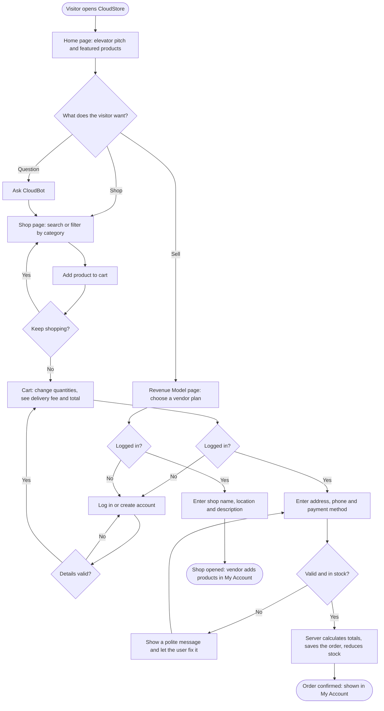

# CloudStore — Design Document

JGA 2026 · Theme: Digital Entrepreneurship for Sustainable Community Development

This document holds the Phase 1 design work for the web application: the
problem statement, variables and parameters, the user flowchart, pseudocode
for the main feature, and IPO tables for every action in the prototype.

---

## 1. Problem statement

Home cooks, small farmers, crafters and other informal vendors in Tshwane's
townships and around its campuses depend on foot traffic and word of mouth, so
they cannot reach customers beyond their street and lose sales to large
retailers. At the same time, students and residents often travel long distances
or pay high prices for everyday goods that are made close by. Most of these
vendors cannot afford to build and run their own website. CloudStore gives any
community vendor a ready-made online shop with delivery, so local money and
local jobs stay in the community.

**Customer:** Thandi, a 20-year-old student in Soshanguve (shopper), and Mama
Grace, a home cook selling meals from her kitchen (vendor).

**Problem in one sentence:** Community vendors have no affordable way to sell
online, and nearby shoppers cannot easily buy from them.

**How it makes money:** a hybrid of e-commerce commission and subscriptions,
chosen because vendors pay nothing until they sell (low risk for them), while
subscriptions give CloudStore predictable monthly income.

---

## 2. Variables and parameters

A **variable** changes as the system runs; a **parameter** is fixed for now.

| Name | Type | Value / example | Where it lives |
|---|---|---|---|
| Delivery fee | Parameter | R35.00 | `Pricing.DELIVERY_FEE` |
| Free-delivery threshold | Parameter | R500.00 (order must be **over** this) | `Pricing.FREE_DELIVERY_THRESHOLD` |
| Starter commission rate | Parameter | 10% | `plans` table |
| Growth commission rate / fee | Parameter | 6%, R149 per month | `plans` table |
| Pro commission rate / fee | Parameter | 3%, R349 per month | `plans` table |
| CloudStore Plus fee | Parameter | R49 per month | `plans` table |
| Max quantity per product | Parameter | 20 | `Pricing.MAX_QUANTITY_PER_ITEM` |
| Days per month (conversion) | Parameter | 30.44 | `Statistics.DAYS_PER_MONTH` |
| Product price | Variable | e.g. R180.00 | `products.price` |
| Stock level | Variable | e.g. 25 | `products.stock` |
| Quantity in cart | Variable | 1–20 | browser cart, `order_items.quantity` |
| Order subtotal | Variable | sum of price × quantity | calculated in `OrderHandler` |
| Order total | Variable | subtotal + delivery fee | `orders.total` |
| Commission earned | Variable | subtotal × plan rate | `orders.commission` |
| Orders per day | Variable | e.g. 1.6 | admin dashboard |
| Number of vendors / Plus members | Variable | e.g. 6 / 3 | `vendors`, `subscriptions` |

### Formulas

```
deliveryFee        = 0    if subtotal > 500 or the shopper has Plus
                   = 35   otherwise
orderTotal         = subtotal + deliveryFee
commission         = subtotal × commissionRate
vendorPayout       = subtotal − commission
ordersPerMonth     = ordersPerDay × 30.44
mean               = sum of order totals ÷ number of orders
median             = middle order total once sorted (average of the two middle values if even)
range              = largest order total − smallest order total
percentage         = part ÷ whole × 100
benefit-cost ratio = total revenue ÷ total costs   (above 1 means benefits outweigh costs)
```

The first-year cash-flow, profit/loss and cost-benefit projection is built
into the **Revenue Model** page (`revenue.html`). Every assumption can be
changed there, and the table can be copied into Excel.

---

## 3. Flowchart — landing page to completed purchase or sign-up



---

## 4. Pseudocode — main feature: placing an order

```
1.  START when the shopper presses "Place order"
2.  IF the shopper is not logged in THEN
3.      SHOW "Please log in or create an account to place your order"
4.      STOP
5.  READ address, phone, payment method and the cart items
6.  IF address is shorter than 5 characters THEN show a message and STOP
7.  IF phone is not a South African number THEN show a message and STOP
8.  IF the cart is empty THEN show "Your cart is empty" and STOP
9.  SET subtotal = 0 and commission = 0
10. FOR EACH item in the cart
11.     LOOK UP the product's current price, stock and the vendor's commission rate
12.     IF the product no longer exists THEN show a message and STOP
13.     IF quantity < 1 OR quantity > 20 THEN show a message and STOP
14.     IF quantity > stock THEN show "Only <stock> left" and STOP
15.     ADD price × quantity to subtotal
16.     ADD price × quantity × commission rate to commission
17. END FOR
18. IF subtotal > 500 OR the shopper has CloudStore Plus THEN
19.     SET deliveryFee = 0
20. ELSE
21.     SET deliveryFee = 35
22. SET total = subtotal + deliveryFee
23. SAVE the order and each item; REDUCE each product's stock
24. EMPTY the cart
25. SHOW "Thank you! Order #<number> has been placed" with the total
26. STOP
```

This pseudocode is implemented in `OrderHandler.placeOrder()` and the
`Pricing` class. The browser repeats steps 6–8 and 18–22 for instant feedback,
but the server always decides the final amounts.

---

## 5. IPO tables

Each table lists the inputs, the processing, the output, and what happens when
an input is invalid. Every error message is polite and tells the user how to
fix it; the server never crashes on bad input.

### 5.1 Register

| Input | Processing | Output |
|---|---|---|
| Full name, email, password, confirm password | Check each field; check the email is not taken; hash the password with PBKDF2; save the user; start a session | Logged in and sent to My Account |

| Invalid input | Response |
|---|---|
| Name shorter than 2 characters | "Please enter your full name." |
| Email without @ or domain | "Please enter a valid email address, for example name@example.com." |
| Password shorter than 8, or no letter/number | "Please choose a password of at least 8 characters with at least one letter and one number." |
| Passwords differ | "The passwords do not match." |
| Email already registered | "An account with that email already exists. Please log in instead." |

### 5.2 Log in

| Input | Processing | Output |
|---|---|---|
| Email, password | Find the user; verify the password against the stored hash; create a session cookie | Logged in; admin goes to Dashboard |

| Invalid input | Response |
|---|---|
| Empty field | "Please enter your email and password." |
| Unknown email or wrong password | "That email and password do not match our records." (the same message for both, so emails are not revealed) |

### 5.3 Search and filter products

| Input | Processing | Output |
|---|---|---|
| Search words, category | Query products whose name, description, category or vendor matches; featured vendors first | Product grid and result count |

| Invalid input | Response |
|---|---|
| Search longer than 60 characters | "Please use a shorter search of up to 60 characters." |
| No matches | "No products match your search. Try another word or category." |

### 5.4 Add to cart / change quantity

| Input | Processing | Output |
|---|---|---|
| Product, quantity (+ / −) | Store the item in the browser cart; recalculate subtotal, delivery fee and total | Updated cart and summary |

| Invalid input | Response |
|---|---|
| More than 20 of one product, or more than in stock | "You can add at most 20 of <product>." |
| Quantity reduced to 0 | Item is removed from the cart |
| Sold-out product | "Add to cart" is replaced by a "Sold out" label |

### 5.5 Checkout (place order)

| Input | Processing | Output |
|---|---|---|
| Cart items, address, phone, payment method | See the pseudocode above | Order number and total; order saved |

| Invalid input | Response |
|---|---|
| Not logged in | "Please log in or create an account to place your order." |
| Address under 5 characters | "Please enter your delivery address (at least 5 characters)." |
| Phone not 0XXXXXXXXX or +27XXXXXXXXX | "Please enter a South African phone number, for example 0712345678." |
| Quantity above stock | "Sorry, only <n> of <product> left in stock. Please lower the quantity." |
| Product deleted | "One of the products in your cart is no longer available…" |
| Tampered cart text | "We could not read your cart. Please refresh the page and try again." |

### 5.6 Subscribe to a plan

| Input | Processing | Output |
|---|---|---|
| Plan; for a new vendor: shop name, location, description | Cancel any other vendor plan; save the subscription; open the shop and make the user a vendor | Confirmation message |

| Invalid input | Response |
|---|---|
| Not logged in | Asked to log in, then returned to the plans |
| Shop name/location under 2 characters, description under 5 | "Please enter a shop name of at least 2 characters." (and similar) |
| Already a Plus member | "You are already a CloudStore Plus member. Enjoy your free delivery!" |
| Admin account | "The admin account cannot open a shop…" |

### 5.7 Add a product (vendor or admin)

| Input | Processing | Output |
|---|---|---|
| Name, description, category, price, stock, emoji (admin also picks a vendor) | Validate; check the shop's plan limit (Starter 10, Growth 100, Pro unlimited); save | "<product> was added to the shop." |

| Invalid input | Response |
|---|---|
| Price 0, negative, letters or over R50 000 | "Please enter a price between R1 and R50000." |
| Stock negative, decimal or over 10 000 | "Please enter a stock quantity between 0 and 10000." |
| Plan limit reached | "This shop has reached its plan limit of 10 products. Upgrade the plan…" |
| Customer (not a vendor) | "Only vendors can add products. Choose a vendor plan…" |

### 5.8 Contact form

| Input | Processing | Output |
|---|---|---|
| Name, email, subject, message | Validate and save to `contact_messages` | "Thanks, <name>! We received your message…" |

| Invalid input | Response |
|---|---|
| Message under 10 characters | "Please write a message of at least 10 characters." |
| Invalid email | "Please enter a valid email address…" |

### 5.9 Ask CloudBot

| Input | Processing | Output |
|---|---|---|
| A question (1–300 characters) | Match keywords (delivery, plans, payment, order status…); otherwise search products by the question's words | An answer, sometimes with product suggestions and "Add" buttons |

| Invalid input | Response |
|---|---|
| Empty question | Nothing is sent |
| Unrecognised question | "Sorry, I didn't catch that. Try asking about a product…" |

### 5.10 Admin: update order status

| Input | Processing | Output |
|---|---|---|
| Order number, new status | Check admin role; update the order | "Order #<n> is now marked as <status>." |

| Invalid input | Response |
|---|---|
| Not an admin | "You do not have access to this area." |
| Unknown status or order | "Please choose a valid status." / "Order #<n> does not exist." |

---

## 6. Database design

| Table | Purpose | Key columns |
|---|---|---|
| `users` | Shoppers, vendors and the admin | `email` (unique), `password_hash` (PBKDF2), `role` |
| `sessions` | Logged-in sessions | `token` (random, 64 hex), `expires_at` |
| `plans` | Starter, Growth, Pro, Plus | `price_monthly`, `commission_rate` |
| `vendors` | Community shops | `owner_user_id`, `plan_id`, `location` |
| `products` | Catalogue | `vendor_id`, `category`, `price`, `stock` |
| `orders` | One row per checkout | `subtotal`, `delivery_fee`, `total`, `commission`, `status` |
| `order_items` | Products in each order | `quantity`, `unit_price`, `commission_rate` (snapshot) |
| `subscriptions` | Active and cancelled plans | `user_id`, `plan_id`, `status` |
| `contact_messages` | Contact form messages | `subject`, `message` |

The schema is created automatically by `Database.java` the first time the app starts.
